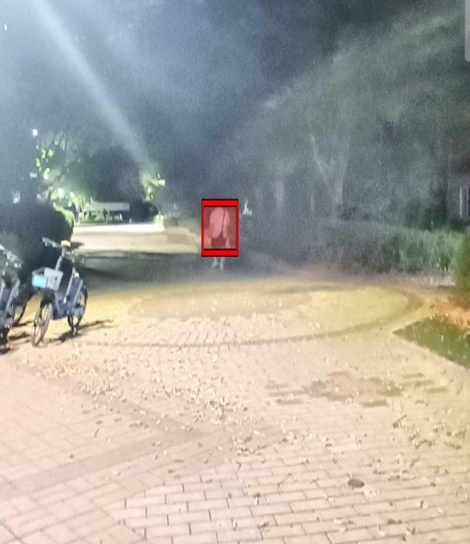
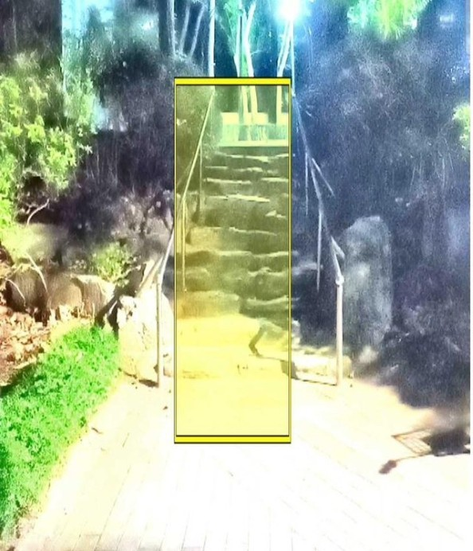
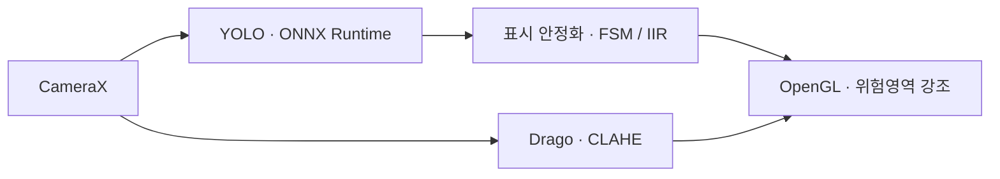

# 밤마실

**야맹증 저시력자의 야간보행을 돕는 실시간 AI 시각보조 서비스**

스마트폰 카메라로 사람·계단·볼라드를 찾아 강조합니다. 시력을 잃어가거나 잔존시력이 있는 사람이 남은 시력으로 밤길의 위험요소를 확인하도록 돕고자 시작했습니다.

🏆 **제8회 K-디지털 트레이닝 해커톤 지정과제 최우수상 (고용노동부 장관상)**

2026.09.04 · [수상 발표](https://www.moel.go.kr/news/enews/report/enewsView.do?news_seq=19887) · [팀장 인터뷰](https://www.mt.co.kr/policy/2026/09/08/2026090814340425566)

## 시연

| 사람 | 계단 | 볼라드 |
|:---:|:---:|:---:|
|  |  |  |

[조도 개선 · Google Cardboard 시연](docs/DEMO.md)

## 담당 역할

서비스 기획·설계를 총괄하고 모델링, 앱 파이프라인, Google Cardboard 실증을 주도했습니다.

- 사용자 문제 정의, 핵심 기능·사용 흐름 설계와 기획서 작성
- AIHub 데이터 정리·리샘플링, YOLO11n 학습, 모델 개선 방향 설정·작업 지시
- 앱 탐지·표시 파이프라인 설계와 개발 지시
- Google Cardboard 실증 기획·진행 지시, 후속 YOLO26 비교 실험

## 앱 구조

탐지는 원본 영상으로, 화면 표시는 밝기·대비를 개선한 영상으로 처리합니다.

## 실험 결과

### 예선 모델 비교

주간 보도 2,146장, person·bollard 평균 mAP50과 데스크톱 추론 시간입니다. 640 조건은 50 epoch, 960 조건은 모델별 30·48 epoch입니다.

- 실야간 데이터 추가 후 보행자 mAP50 **0.127 → 0.684**
- 배경 이미지 추가 후 야간 계단 오탐 **22 → 9건** (본선 실험)
- Galaxy A34에서 화면 표시 **29.9 FPS**, 탐지 갱신 **3.4 FPS**

[예선 실험 표·학습 곡선·크기별 Recall](docs/PRELIMINARY_RESULTS.md) · [negative 학습 기록](docs/MODEL_EXPERIMENTS.md)

### 후속 YOLO26 학습

NMS 후처리 병목을 줄이고 더 큰 모델을 적용하기 위해 n·s·m을 비교했습니다. 공통 조건은 **50 epochs · batch 16 · seed 0**, RTX 4080 SUPER입니다.

| 모델 | 입력 | 개발셋 mAP50–95 | 학습 시간(분) |
|---|---:|---:|---:|
| YOLO26n | 640 | 0.59884 | 83.4 |
| YOLO26s | 640 | 0.63822 | 88.0 |
| YOLO26m | 640 | 0.64738 | 118.3 |
| YOLO26n | 960 | 0.61995 | 102.3 |
| YOLO26s | 960 | **0.66632** | 134.6 |

각 조건은 1회 학습했으며 개발셋 best checkpoint 기준입니다. **s960이 가장 높았고**, 최종 모델은 외부 평가와 스마트폰 지연시간을 확인한 뒤 선택할 예정입니다.

[5개 실험 설정·결과·곡선](docs/experiments/README.md) · [데이터 구성](docs/DATASET.md) · [학습·평가 실행 방법](docs/REPRODUCE_YOLO26.md)

## 팀 저장소

[비전 모델링](https://github.com/kty2001/KDT_Hackathon) · [파이프라인·앱](https://github.com/jh4995/night-walk)
