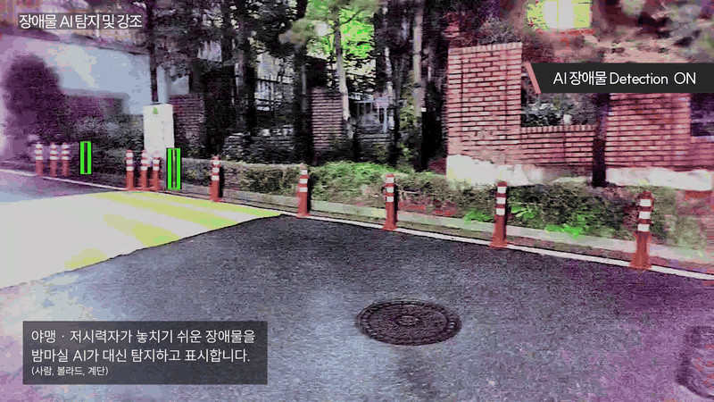
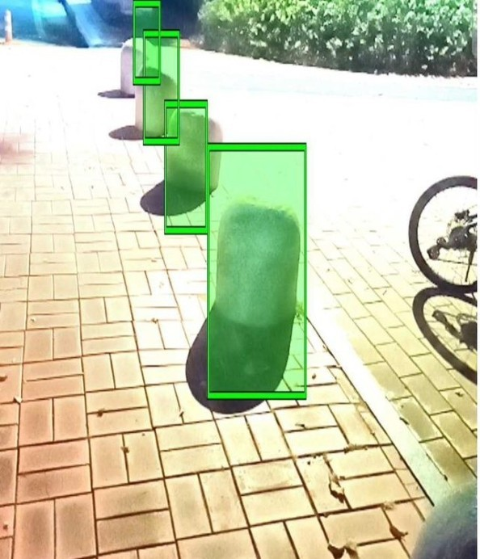
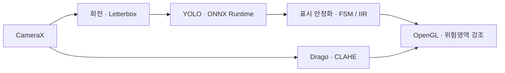
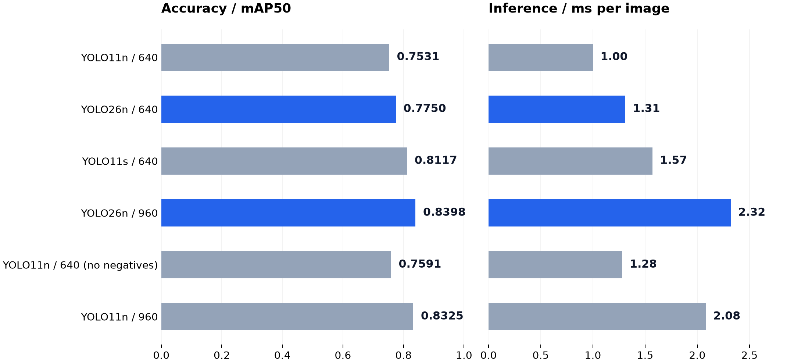
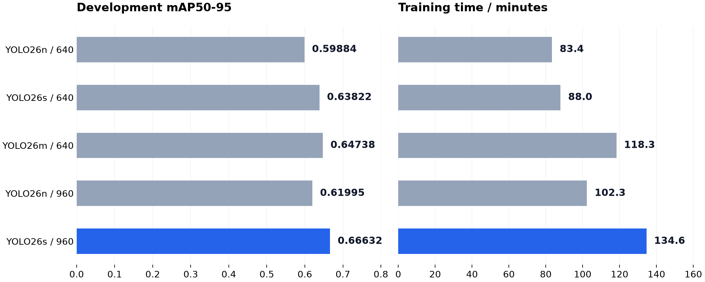

# 밤마실

**야맹증 저시력자의 야간보행을 돕는 실시간 AI 시각보조 서비스**

스마트폰 카메라로 사람·계단·볼라드를 찾아 강조하고, 밝기·대비를 개선해 야간 보행을 돕습니다.

🏆 **제8회 K-디지털 트레이닝 해커톤 지정과제 최우수상 (고용노동부 장관상)**

2026.09.04 · [수상 발표](https://www.moel.go.kr/news/enews/report/enewsView.do?news_seq=19887) · [팀장 인터뷰](https://www.mt.co.kr/policy/2026/09/08/2026090814340425566)

## 시연

| 사람 | 계단 | 볼라드 |
|:---:|:---:|:---:|
|  |  |  |

[조도 개선 · Google Cardboard 시연](docs/DEMO.md)

## 기획 배경

전맹을 위한 음성 안내 서비스는 있지만, 시력을 잃어가거나 잔존시력이 있는 사람이 **남은 시력을 활용하도록 돕는 지원은 부족하다**는 문제의식에서 시작했습니다. 밤마실은 사용자가 밤길의 위험요소를 직접 보고 피할 수 있도록 화면을 개선하고 탐지 영역을 강조합니다.

사람·계단을 기본 탐지 대상으로 삼고, 당사자 인터뷰에서 반복적으로 충돌한다고 언급한 볼라드를 추가했습니다.

## 담당 역할 — 팀장

**서비스 기획부터 설계, 모델링·앱 개발 방향 설정, 실증까지 프로젝트 전반을 총괄했습니다.**

- **서비스 기획·설계:** 대상 사용자와 문제 정의, 핵심 기능·사용 흐름 설계, 개발 우선순위 결정, 기획서 작성
- **모델링:** 탐지 대상·학습·평가 방향 설정과 개선 작업 지시. AIHub 데이터 직접 정리·리샘플링, YOLO11n 학습
- **앱 파이프라인:** 입력·탐지·화면 표시 구조 설계, 개발 요구사항 수립과 구현·개선 작업 지시
- **실증:** Google Cardboard 착용 환경 실증 기획과 진행 지시
- **후속 개선:** YOLO26 모델 크기·입력 해상도 비교 실험과 결과 정리

## 앱 구조

처음에는 저조도 개선 후 탐지하는 순차 구조를 계획했습니다. 비교 실험에서 개선 영상을 탐지에 넣었을 때 계단 오탐이 늘어, **원본 탐지와 개선 화면 표시를 분리**했습니다. 카메라 입력부터 탐지·강조까지 스마트폰 안에서 처리합니다.

탐지 결과는 좌표를 원본 화면에 맞게 복원한 뒤, FSM으로 반복 확인된 대상을 표시하고 IIR smoothing으로 박스 흔들림을 줄입니다. 화면에는 Drago 톤 매핑과 CLAHE를 적용해 밝기·대비를 조정합니다.

## 데이터와 모델 개선

AIHub 인도보행 데이터를 직접 정리·리샘플링하고, 계단은 StairNet을 사용했습니다. 합성 저조도 데이터 중심 학습의 야간 성능을 보완하기 위해 NightOwls의 실제 야간 보행자 데이터를 추가했습니다.

계단이 없는 보도에서 계단이 검출되는 문제에는 **negative 학습**을 적용했습니다. 탐지 대상이 없는 배경 이미지에 빈 라벨을 넣는 방식으로, 본선 실험에서는 AIHub 보도 배경 1,163장을 추가해 야간 계단 오탐을 **22건에서 9건으로** 줄였습니다.

후속 YOLO26 실험은 학습 **10,919장**, 개발 **787장**의 동일한 분할로 비교했습니다. 클래스는 사람·계단·볼라드이며, 학습 데이터에는 빈 라벨 이미지 926장이 포함됩니다.

[데이터 구성](docs/DATASET.md) · [negative 학습 기록](docs/MODEL_EXPERIMENTS.md)

## 실험 결과

### 예선 모델 비교

주간 보도 2,146장, person·bollard 평균 mAP50과 데스크톱 추론 시간입니다. 640 조건은 50 epoch, 960 조건은 모델별 30·48 epoch입니다.

실야간 데이터 추가 후 NightOwls 평가에서 보행자 mAP50은 **0.127 → 0.684**, Recall은 **0.195 → 0.609**로 개선됐습니다. 소형 볼라드는 960 입력에서 탐지율이 높아졌지만, 추론 시간도 함께 늘었습니다.

[예선 실험 표·학습 곡선·크기별 Recall](docs/PRELIMINARY_RESULTS.md)

### 후속 YOLO26 학습

NMS 후처리 병목을 줄이고 더 큰 모델을 적용하기 위해 n·s·m을 비교했습니다. 공통 조건은 **50 epochs · batch 16 · seed 0**, RTX 4080 SUPER입니다.

각 조건은 1회 학습했으며 개발셋 best checkpoint 기준입니다. **s960이 가장 높았고**, 640 입력에서 s와 m의 차이는 약 0.92%p였습니다. 최종 모델은 외부 평가와 스마트폰 지연시간을 확인한 뒤 선택할 예정입니다.

[5개 실험 설정·결과·곡선](docs/experiments/README.md) · [데이터 구성](docs/DATASET.md) · [학습·평가 실행 방법](docs/REPRODUCE_YOLO26.md)

입력 640으로 맞춘 외부 평가에서는 **볼라드 m640(AP50–95 0.54103), 야간 보행자 s640(0.36345)**이 가장 높았습니다. [외부 평가 비교](docs/experiments/external-640/README.md)

## 실기기 측정과 착용 실증

Galaxy A34에서 720p 앱을 11분씩 6회 연속 실행했습니다. 화면 표시는 **29.9 FPS**였지만 탐지 갱신은 **3.4 FPS**, 추론은 **251–263ms/회**로 느렸습니다. 화면 재생과 탐지 속도를 나눠 측정한 결과가 NMS-free 모델을 검토한 출발점이 됐습니다.

Google Cardboard를 활용한 착용 환경 실증도 기획·진행했습니다. 스마트폰 구현을 바탕으로 착용형 화면을 확인하고, 향후 스마트글라스 확장 가능성을 검토했습니다.

[실기기 측정 상세](docs/PRELIMINARY_RESULTS.md) · [Cardboard 시연](docs/DEMO.md)

다음 작업은 **960 입력 추가 평가·오탐/미탐 분석 → 배포 변환 전후 정확도 확인 → 스마트폰 지연시간·연속 구동 측정**입니다.

## 팀 저장소

[비전 모델링](https://github.com/kty2001/KDT_Hackathon) · [파이프라인·앱](https://github.com/jh4995/night-walk)
