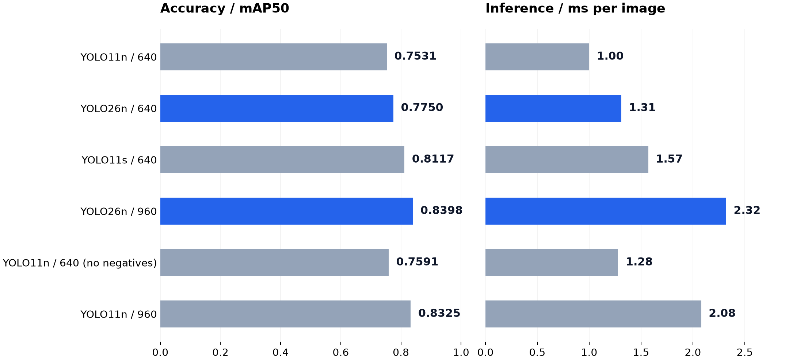
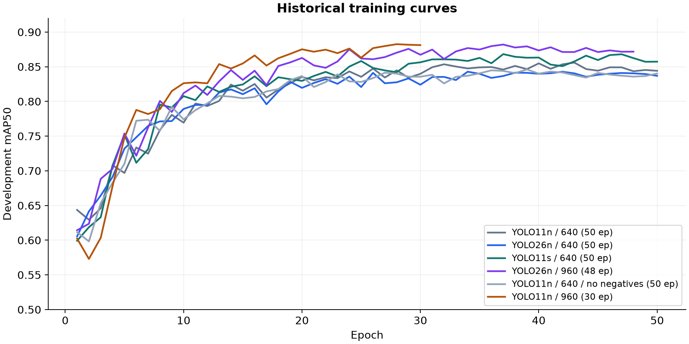
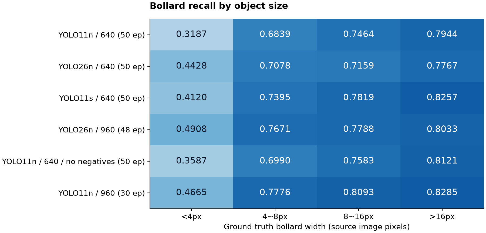

## 예선 실험과 실기기 측정

YOLO11n·11s·26n을 비교했습니다. YOLO26n은 640 입력에서 mAP50 0.7750, 960에서 0.8398을 기록했습니다.

| 모델 | 입력 | Epoch | mAP50 | mAP50–95 | 추론(ms/장) |
|---|---:|---:|---:|---:|---:|
| YOLO11n | 640 | 50 | 0.7531 | 0.4505 | 1.00 |
| YOLO26n | 640 | 50 | 0.7750 | 0.4674 | 1.31 |
| YOLO11s | 640 | 50 | 0.8117 | 0.5138 | 1.57 |
| YOLO26n | 960 | 48 | 0.8398 | 0.5403 | 2.32 |
| YOLO11n (배경 제외) | 640 | 50 | 0.7591 | 0.4554 | 1.28 |
| YOLO11n | 960 | 30 | 0.8325 | 0.5322 | 2.08 |

주간 보도 2,146장 기준, person·bollard 평균 mAP입니다. 추론 시간은 데스크톱 측정값입니다.

| 항목 | 예선 결과 | 측정 조건 |
|---|---|---|
| 보행자 mAP50 | 0.127 → 0.684 | 실야간 데이터 추가 전후, NightOwls rec34 1,001장 |
| 보행자 Recall | 0.195 → 0.609 | 같은 평가셋 |
| 화면 표시 | 29.9 FPS | Galaxy A34, 720p |
| 탐지 갱신 | 3.4 FPS | 추론 251–263 ms/회 |
| 취득 → 표시 지연(p50) | 75.6–78.8 ms / 야간 91.3–93.5 ms | Galaxy A34 |
| 연속 구동 | 11분 × 6회, 35.1 → 40.5°C | 동일 시험 반복 |

예선 학습 곡선 · 볼라드 크기별 탐지 성능

소형 볼라드에서 Recall이 낮아졌고, 960 입력에서 개선을 확인했습니다.

[예선 실험 상세](experiments/preliminary/README.md)
