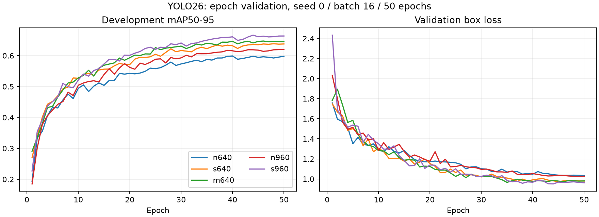

# YOLO26 실험 근거

2026년 10월 7일 완료한 다섯 실험의 기록이다. 같은 데이터 분할에서 seed 0, batch 16, 50 epochs로 학습했다.

[집계 CSV](comparison.csv) · [전체 요약 JSON](yolo26-summary.json) · [실험 해석과 한계](../MODEL_EXPERIMENTS.md)

## 실행별 기록

| 조건 | 실행 설정 | 최종 best 검증 | Epoch 기록 | 학습 곡선 | 완료·해시 |
|---|---|---|---|---|---|
| n640 | [설정](n640/settings.json) | [결과](n640/progress.json) | [CSV](n640/results.csv) | [그래프](n640/results.png) | [완료](n640/training_complete.json) · [SHA-256](n640/provenance.json) |
| s640 | [설정](s640/settings.json) | [결과](s640/progress.json) | [CSV](s640/results.csv) | [그래프](s640/results.png) | [완료](s640/training_complete.json) · [SHA-256](s640/provenance.json) |
| m640 | [설정](m640/settings.json) | [결과](m640/progress.json) | [CSV](m640/results.csv) | [그래프](m640/results.png) | [완료](m640/training_complete.json) · [SHA-256](m640/provenance.json) |
| n960 | [설정](n960/settings.json) | [결과](n960/progress.json) | [CSV](n960/results.csv) | [그래프](n960/results.png) | [완료](n960/training_complete.json) · [SHA-256](n960/provenance.json) |
| s960 | [설정](s960/settings.json) | [결과](s960/progress.json) | [CSV](s960/results.csv) | [그래프](s960/results.png) | [완료](s960/training_complete.json) · [SHA-256](s960/provenance.json) |

## 학습 곡선 비교



곡선은 각 `results.csv`의 1–50 epoch 기록이다. README의 점수는 학습 종료 후 best checkpoint를 재검증한 `progress.json`의 값이므로, CSV의 마지막 epoch나 최대 점수와 반드시 같지는 않다. `comparison.csv`도 이 최종 best 검증값을 사용한다.

## 파일과 출처

- `settings.json`: 원본 `run_manifest.json`의 실행 설정과 Python·PyTorch·Ultralytics·GPU 환경. 개인 경로 네 항목만 상대 경로로 치환했고 항목명을 파일에 기록했다.
- `progress.json`, `results.csv`, `results.png`: 원본 그대로 보존했다.
- `training_complete.json`: 완료 상태·경과 시간·best 체크포인트 해시. 체크포인트 경로만 상대 경로로 바꿨다.
- `provenance.json`: 원본 파일과 공개 파일의 SHA-256, 학습 데이터 manifest·사전학습 모델·best 체크포인트 해시. 원본 경로는 로컬 기록 식별자이며 웹 링크가 아니다.

체크포인트 SHA-256은 로컬 가중치 파일을 직접 읽어 완료 기록과 대조했다. 해시는 파일 식별용이며, 가중치나 학습 데이터 자체는 포함하지 않는다. 데이터 manifest 해시는 실행 기록에 보관된 값이다.

## 원본에서 다시 추출

저장소 루트에서 Python 3.11 이상으로 실행한다. 인자는 다섯 실험의 `outputs` 폴더가 있는 원본 작업 디렉터리다.

```sh
python tools/export_experiment_evidence.py /path/to/training-workspace
```

추출기는 원본 기록·체크포인트 해시, 설정·최종 점수 일치, 50 epoch 연속 기록을 검사한 뒤 공개 파일과 집계 CSV를 만든다. 비교 그림은 각 CSV의 `metrics/mAP50-95(B)`와 `val/box_loss`를 사용했다. 학습·평가 실행 방법은 [재현 절차](../REPRODUCE_YOLO26.md)에 정리했다.
