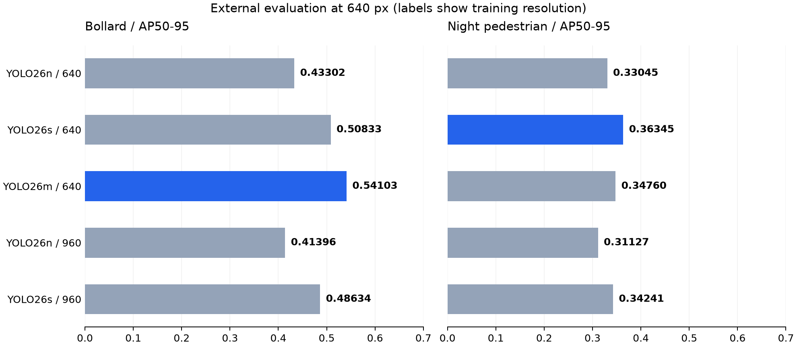

# YOLO26 외부 평가 — 입력 640 고정

다섯 후보 모두 입력 640, batch 16, FP32, confidence 0.001, IoU 0.7, max_det 300, rect=False로 평가했다. 모델 이름의 640·960은 **학습 해상도**다.



| 학습 조건 | 볼라드 AP50 | 볼라드 AP50–95 | 야간 사람 AP50 | 야간 사람 AP50–95 |
|---|---:|---:|---:|---:|
| n640 | 0.74047 | 0.43302 | 0.63576 | 0.33045 |
| s640 | 0.81742 | 0.50833 | 0.68401 | 0.36345 |
| m640 | 0.84890 | 0.54103 | 0.65616 | 0.34760 |
| n960 | 0.71107 | 0.41396 | 0.59890 | 0.31127 |
| s960 | 0.79355 | 0.48634 | 0.66079 | 0.34241 |

640 입력에서 볼라드 AP50–95는 m640(0.54103), 야간 사람은 s640(0.36345)이 가장 높았다. 두 조건을 우선 모바일 후보로 두되, 속도·발열과 실패 사례까지 확인해 선택한다. s960의 개발셋 최고 점수만으로 최종 모델을 정하지 않는다.

960 학습 모델도 640으로 평가한 결과다. 960 입력 자체의 이점은 별도 평가가 필요하다. 각 학습은 seed 0 한 번이며, 이번 비교가 반복 실험의 통계적 우위를 뜻하지는 않는다.

## 평가 데이터

- 볼라드: 기존 2,146장에서 개발셋과 겹치는 61장을 제외한 2,085장. person·bollard AP를 기록하고 위 표에는 bollard만 표시했다.
- 야간 사람: NightOwls rec34 1,001장, person 전용 평가. 혼합 ignore 영역을 공식 평가 방식으로 마스킹하지 않는 기존 한계가 남아 있다.

두 데이터는 과거에도 사용한 회귀 평가셋이다. 새 블라인드 테스트가 아니며, 보행 시점의 원거리 계단이나 야간 볼라드를 검증하지 않는다.

## 실행과 근거

n640·m640의 2026년 10월 7일 완료 기록 4건은 가중치·데이터 해시와 설정을 확인해 재사용했다. s640·n960·s960의 6건은 2026년 11월 23일 기존 Windows·RTX 4080 SUPER 환경에서 실행했다. 재학습은 하지 않았다.

[집계 CSV](comparison.csv)에 15개 클래스별 AP를 담았다. 각 실행 JSON에는 설정·가중치 및 데이터 해시·원본 결과 해시·기록 출처가 있다. 시간은 데스크톱 검증 배치의 측정값이며, 서로 다른 세션에서 얻었으므로 통제된 모바일 속도 비교로 사용하지 않는다.

| 후보 | 볼라드 세트 기록 | 야간 사람 기록 |
|---|---|---|
| n640 | [JSON](n640-bollard_dev_disjoint.json) | [JSON](n640-nightowls_rec34.json) |
| s640 | [JSON](s640-bollard_dev_disjoint.json) | [JSON](s640-nightowls_rec34.json) |
| m640 | [JSON](m640-bollard_dev_disjoint.json) | [JSON](m640-nightowls_rec34.json) |
| n960 | [JSON](n960-bollard_dev_disjoint.json) | [JSON](n960-nightowls_rec34.json) |
| s960 | [JSON](s960-bollard_dev_disjoint.json) | [JSON](s960-nightowls_rec34.json) |

정밀도 설정은 Ultralytics 8.4.106에서 `half=False`를 `quantize=None`으로 변환한다. 원본 두 표기를 FP32로 정규화해 대조했다.

실행 예:

```sh
python tools/yolo26.py evaluate --run s640 --weights /path/to/s640/best.pt --dataset bollard_dev_disjoint --workspace outputs/reproduction --output outputs/evaluation/s640-bollard
```

[데이터 준비 및 공통 실행 방법](../../REPRODUCE_YOLO26.md)

기록 추출·그래프 재생성:

```sh
python tools/export_external_evaluation.py /path/to/training-workspace /path/to/external-evaluations
python tools/plot_external_evaluation.py
```
